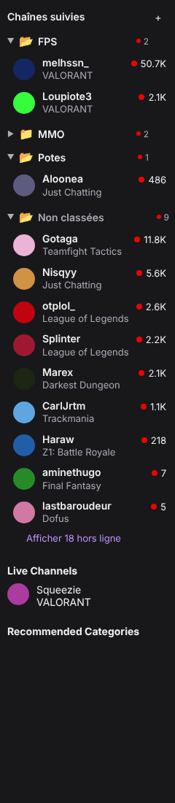

# 📂 FollowFolders

Extension Chrome qui range les **chaînes suivies** de la barre latérale Twitch dans des **dossiers** que l'on ouvre et ferme d'un clic.



- La section « Followed Channels » de Twitch est remplacée par vos dossiers ; **« Live Channels » et le reste de la barre restent en dessous**, inchangés.
- Chaque dossier a un **nom** et s'ouvre 📂 / se ferme 📁 ; l'état est mémorisé.
- Nombre de chaînes en live affiché sur chaque dossier, même fermé.
- Chaînes rangées par **glisser-déposer** ou via le bouton **⋯** d'une chaîne.
- Dossiers renommables, supprimables, réordonnables (glisser-déposer ou menu ⋯).
- Dossier **« Non classées »** pour tout ce qui n'est pas encore rangé.
- Charge toute la liste automatiquement (clique sur « Show More » à votre place).
- **100 % local** : aucune connexion Twitch, aucune API, aucun serveur. Les dossiers sont enregistrés dans `chrome.storage.local` ; export / import JSON pour les sauvegarder.
- Si Twitch change son site et que l'extension ne s'y retrouve plus, la liste Twitch d'origine réapparaît.

<br clear="right" />

## Installer (mode développeur)

1. Récupérer le fichier `follow-folders-vX.Y.Z.zip` dans les [Releases](../../releases) et le dézipper — ou compiler soi-même (voir plus bas).
2. Ouvrir `chrome://extensions` et activer le **mode développeur** (en haut à droite).
3. Cliquer sur **« Charger l'extension non empaquetée »** et choisir le dossier dézippé (celui qui contient `manifest.json`).
4. Recharger twitch.tv.

Fonctionne aussi sur Edge, Brave et Opera (navigateurs Chromium).

## Utiliser

| Action                                                | Comment                                                            |
| ----------------------------------------------------- | ------------------------------------------------------------------ |
| Créer un dossier                                      | bouton **+** à droite de « Chaînes suivies », taper le nom, Entrée |
| Ouvrir / fermer                                       | clic sur le dossier                                                |
| Ranger une chaîne                                     | la glisser sur un dossier, ou survol → **⋯** → choisir le dossier  |
| Sortir une chaîne d'un dossier                        | la glisser sur « Non classées », ou **⋯** → « Retirer du dossier » |
| Renommer / supprimer / déplacer un dossier            | survol du dossier → **⋯** (ou glisser le dossier)                  |
| Désactiver, tout ouvrir / fermer, exporter / importer | icône de l'extension dans la barre de Chrome                       |

En mode barre latérale réduite (icônes seulement), Twitch reste tel quel.

## Développer

Prérequis : Node.js 22 (voir `.nvmrc`).

```bash
npm install
npm run dev        # build en continu + rechargement à chaud : charger le dossier dist/ dans chrome://extensions
npm run build      # build de production dans dist/
npm run zip        # release/follow-folders-vX.Y.Z.zip
```

| Commande                          | Rôle                                                                                                                                                                                |
| --------------------------------- | ----------------------------------------------------------------------------------------------------------------------------------------------------------------------------------- |
| `npm run lint` / `npm run format` | ESLint / Prettier                                                                                                                                                                   |
| `npm run typecheck`               | vérification TypeScript                                                                                                                                                             |
| `npm test`                        | tests unitaires (Vitest) : modèle de données, stockage, lecture du DOM                                                                                                              |
| `npm run test:e2e`                | tests de bout en bout (Playwright) : l'extension compilée est chargée dans Chromium sur une imitation de Twitch (`e2e/fixtures/twitch-sidebar.html`) — lancer `npm run build` avant |

### Organisation du code

```
src/
  content/
    selectors.ts   ← TOUS les sélecteurs CSS de Twitch (le seul fichier à corriger si Twitch change)
    reader.ts      ← lecture des chaînes dans la barre latérale
    render.ts      ← construction du HTML des dossiers
    index.ts       ← contrôleur : observation de la page, actions, glisser-déposer
    styles.css     ← styles, basés sur les variables de couleur de Twitch (thème clair et sombre)
  shared/
    model.ts       ← logique pure (dossiers, tri, vue) — testée
    storage.ts     ← chrome.storage.local, validation, migrations, export / import
    types.ts       ← format des données (SCHEMA_VERSION)
    strings.ts     ← textes de l'interface
  popup/           ← fenêtre de l'icône de l'extension
e2e/               ← tests Playwright + page d'imitation de Twitch
tests/             ← tests Vitest
```

### Quand Twitch change son site

1. Ouvrir twitch.tv, F12, inspecter la barre latérale.
2. Corriger `src/content/selectors.ts` (préférer les attributs `data-a-target` / `data-test-selector` aux classes générées).
3. Si la structure a changé, mettre à jour `e2e/fixtures/twitch-sidebar.html` pour qu'elle reste fidèle.
4. `npm test && npm run build && npm run test:e2e`.

## Versions et publication

- Versionnage sémantique ; la version de `package.json` est copiée dans le `manifest.json`.
- Historique dans [CHANGELOG.md](CHANGELOG.md), règles de contribution dans [CONTRIBUTING.md](CONTRIBUTING.md).
- Publier une version : mettre à jour `CHANGELOG.md`, puis
  ```bash
  npm version minor          # ou patch / major : met à jour package.json + crée le tag vX.Y.Z
  git push --follow-tags
  ```
  GitHub Actions vérifie, compile et crée la Release avec le `.zip`.

## Confidentialité

FollowFolders ne collecte et n'envoie aucune donnée. Il lit uniquement la barre latérale de twitch.tv dans votre navigateur et enregistre vos dossiers localement (`chrome.storage.local`). Seule permission demandée : `storage`.

## Licence

[MIT](LICENSE). Projet indépendant, non affilié à Twitch ni à Amazon.
